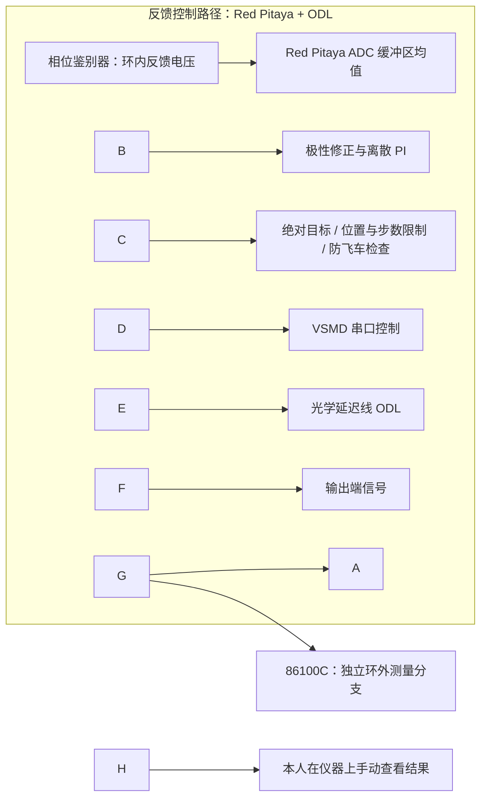

# Phase Stabilization with Discrete PI

本项目包含 **Red Pitaya 上的离散 PI 闭环补偿实现**，以及 **86100C 独立环外测量的实验使用方式**。Red Pitaya 读取相位鉴别器反馈电压，完成 ODL 归零、工作点建立与极性标定，再通过 VSMD 串口命令调整光学延迟线。86100C 独立观察输出端信号；本人当前实验是在仪器上手动查看测量结果。

用于 PI 的鉴相电压属于**环内反馈**，86100C 对独立输出信号的观测属于**环外测量**。示波器读数不输入 PI，也不参与控制量计算。正式实验可以关闭板端数据记录，直接运行 C++ 程序。

!\[系统框图](docs\\系统框图.png)



图示表达控制与观测关系，具体实验接线须以实际系统为准。相位与电压的换算需要实验标定；本仓库没有给出环外实测稳定度、机械到位精度或硬实时指标。

## 真实硬件运行：板端控制，86100C 手动观测

在 Red Pitaya 的 Linux 环境中，需要 SDK 的 `rp.h` / `librp` 以及适当调度权限。先按实际设备确认配置与串口路径；`config.txt` 是完整示例，默认参数用于离线演示，不代表具体硬件已验证的设置。

```sh
# 在公开项目根目录构建 Red Pitaya 版本
cmake -S . -B build-rp -DUSE\_REAL\_HARDWARE=ON -DREDPITAYA\_ROOT=/opt/redpitaya
cmake --build build-rp --parallel

# /dev/ttyUSB0 仅为路径示例，替换为实际连接 ODL 驱动器的串口
export PI\_SERIAL\_DEVICE=/dev/ttyUSB0
# 板端 PI 控制，不保存板端数据；86100C 在仪器上独立手动查看
./build-rp/PhaseStabilization ./config.txt --log-mode off
```

需要保存板端记录时运行：

```sh
export PI\_SERIAL\_DEVICE=/dev/ttyUSB0
./build-rp/PhaseStabilization ./config.txt --log-mode full
# 省略 --log-mode 也使用 full
```

硬件运行时长由现有 `TOTAL\_DURATION\_MIN` 决定，可用 Ctrl+C 正常请求退出。`--simulation-seconds` 仅用于离线构建，硬件版本会在初始化设备前拒绝该选项。

环外实验应记录实际使用的 **86100C 测量项、参考方式和测量窗口**，并注明手动查看结果的实验条件。当前仅确认独立观察输出端信号和手动查看这一方式；未提供具体测量设置、接线或实测数值，因此不预设测量指标。已有 Python 仪器工具是可选工具，不是此手动实验的必需步骤。

PI 输出是绝对逻辑目标位置；控制包括死区冻结、积分反算、整数物理目标转换、位置边界、每拍步数限制与原有故障停机。控制频率为 20 Hz，积分使用名义 0.05 s。详细配置、保护机制和测量限制见 [设计说明](docs/DESIGN.md)。

## 项目结构与使用权限

`control/` 实现 PI；`startup/` 建立工作点；`hal/` 提供硬件与仿真接口；`comm/` 解析驱动帧；`utils/` 提供保护和日志；`tools/` 提供可选 PI 自动化与分析；`tests/` 使用合成数据和 mock 验证。

没有为整个项目指定开源许可证。公开源码的使用、修改和分发权限需由权利人另行确定；第三方依赖遵循各自声明，见 [依赖说明](THIRD_PARTY_NOTICES.md)。

