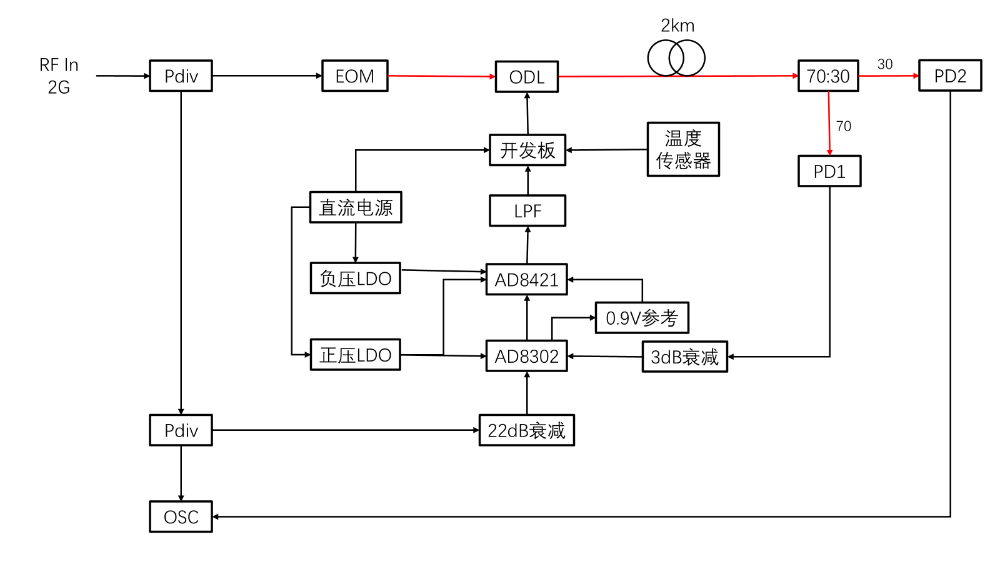

# Phase Stabilization with Discrete PI

本项目用于光纤射频传输链路的相位漂移补偿。Red Pitaya 采集环内鉴相电压，通过离散 PI 控制光学延迟线（ODL），实现归零、工作点建立、极性标定与闭环补偿。86100C 用于输出端独立环外观测，测量结果不参与反馈控制。



## 主要功能

- **自动启动**：ODL 归零、归中、工作点搜索与控制极性标定。
- **离散 PI 控制**：死区冻结、积分抗饱和反算、绝对位置输出，以及位置和每拍步数限幅。
- **运行管理**：VSMD 串口控制、异常停机、可选数据记录和正常退出。

## 硬件运行与环外观测

板端需要 Linux、支持 C++14 的编译器、CMake，以及 Red Pitaya SDK（`rp.h`、`librp`）。运行前按实际硬件调整 `config.txt` 中的 PI 参数、位置范围和步数限制。

以下命令在仓库根目录执行：

```bash
cmake -S . -B build-hw -DUSE_REAL_HARDWARE=ON -DBUILD_TESTING=OFF
cmake --build build-hw --parallel
sudo env PI_SERIAL_DEVICE=/dev/ttyUSB0 ./build-hw/PhaseStabilization config.txt --log-mode off
```

将 `/dev/ttyUSB0` 替换为实际串口路径。程序完成启动流程后进入 PI 闭环控制，86100C 的测量结果在仪器上手动查看。

`--log-mode off` 关闭板端数据文件，仅保留终端状态输出；默认的 `--log-mode full` 保存控制数据与诊断记录。运行时长由 `config.txt` 中的 `TOTAL_DURATION_MIN` 设置，按 `Ctrl+C` 请求停止并退出。

## 项目结构

| 路径 | 功能 |
|---|---|
| `main.cpp` | 启动流程、闭环调度与退出处理 |
| `control/` | 离散 PI 与物理步数限制 |
| `startup/` | 归零、工作点建立与极性标定 |
| `hal/` | Red Pitaya 硬件接口与仿真接口 |
| `comm/` | VSMD 通信帧解析 |
| `utils/` | 命令审核、运行保护与数据记录 |
| `tools/` | 可选的实验自动化与数据分析 |
| `tests/` | 控制逻辑、通信、日志和工具测试 |

配置、控制逻辑与日志格式见[设计说明](docs/DESIGN.md)。自动化测试记录见 [GitHub Actions](https://github.com/yunyunhuaihuai/Phase_Stabilization_PI/actions)。

## 许可证

本仓库暂未指定开源许可证。第三方依赖说明见 [THIRD_PARTY_NOTICES.md](THIRD_PARTY_NOTICES.md)。