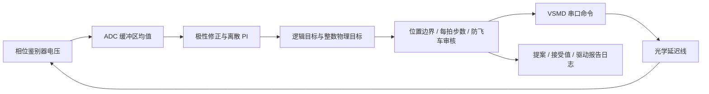

# Phase Stabilization with Discrete PI

一个用于光电实验的 C++14 控制项目：读取相位鉴别器电压，完成光学延迟线的归零、工作点搜索与极性标定，再通过串口调整延迟线的绝对目标坐标。项目包含离线仿真、运动保护、异步日志和 Python 实验自动化，便于在没有仪器的电脑上审阅和演示。

硬件接口面向 Red Pitaya 与使用 VSMD 协议的步进驱动器。相位鉴别器输出是**环外电压误差**；电压与相位的转换需要实验标定。驱动器内部位置报告不能代替机械编码器或独立链路时延测量。本项目没有给出仪器实测稳定度、机械到位精度或硬实时保证。


## PI 输出与限幅

PI 计算的是**绝对逻辑目标位置**。每拍先计算经标定极性修正的误差 `e = polarity × (target − voltage)`，再计算 `P = Kp × e`、积分候选 `I + Ki × e × 0.05`。从 `P + I_candidate` 减去上拍逻辑目标得到增量，用于每拍限幅；最终输出仍是绝对目标。

步数饱和时，积分反算为 `I = limited_logical_candidate − P`；位置边界触发时同样反算。`|e| < deadband` 时保持上拍目标并冻结积分。初始化把积分和逻辑位置设为当前命令坐标，并注入标定极性；没有用标定增益自动重新整定 PI。

逻辑目标转换为整数时向零截断。负方向的物理目标为 `trunc(logical) − BACKLASH_STEPS`，正方向为 `trunc(logical)`，然后检查位置边界。此偏移按方向应用，不能解读为每次换向追加一段运动。默认偏移为零。

- 控制器的有效逻辑步数上限为 `min(MAX_STEP_PER_CYCLE, MAX_PHYSICAL_DELTA − BACKLASH_STEPS)`。
- 转换后若恰好多出一个脉冲，量化修正把物理目标压回每拍上限，并同步重置逻辑位置和积分。
- 发送审核再次检查整数目标的总行程与相对**上次软件接受目标**的物理步数。更大的越界提案被拒绝并停机。

控制器内部记录的是提出的目标。发送失败或审核拒绝后，主程序立即走故障停机路径，不继续使用已经前移的 PI 内部状态控制。

## 启动与保护

启动顺序为驱动配置、日志创建、归零、归中、盲扫、锚点两侧斜率检查、四点同向标定、最终有限采样检查和 PI 初始化。归零使用有超时与清理顺序的 `HomeWithSafety`；运动完成判定使用驱动内部状态及目标一致性。锚点斜率须同号且幅值 ≥ `0.5 × BASE_B0`；四点标定须 `R² ≥ 0.93`。这些门槛没有在演示中绕过。

发送前的防飞车检查保留以下软件判据：连续五拍误差增大且同向饱和；同向提案累计位移超过 200000 脉冲；误差超过 150 mV 持续 50 拍。只有连续 21 个合格样本满足误差 ≤ 0.5 mV、提案步数 ≤ 200 且未饱和，才重置同向位移累计。保护阈值没有经过本项目的硬件安全认证。

非有限相位输入、越界、保护触发、发送失败、队列满或日志错误都会使运行失败。干净串口上请求有地址的停止命令并做限时状态查询；出现非空 ASCII 短写后，连接永久隔离，不追加换行、重试或停机字节。此时软件报告停止状态未知，需要操作者通过独立硬件措施处理。

## 配置

`config.txt` 是完整的 PI 示例。默认参数用于离线演示，不能直接当作任何具体设备已验证的设置。未知键、非法数值和非有限值使加载失败。C++ 加载使用默认值补齐缺省项；重复键采用后值。Python 正式实验入口要求完整、无重复的已知键集合。

| 键 | 默认值 | 用途 / 校验 |
|---|---:|---|
| `CONTROL_FREQ_HZ` | 20 | 仅接受 20；PI 使用名义 0.05 s |
| `KP` / `KI` | 40 / 3200 | 比例、积分系数；非负且有限 |
| `TARGET_VPHS_MV` | 0 | 环内目标，绝对值 ≤ 900 mV |
| `DEADBAND_MV` | 0.15 | 严格小于此值时冻结，范围 0–2 mV |
| `MAX_STEP_PER_CYCLE` | 5500 | 逻辑每拍上限，1–8000 脉冲 |
| `MAX_PHYSICAL_DELTA` | 5500 | 软件接受目标之间的物理上限，≤ 8000 |
| `BACKLASH_STEPS` | 0 | 负向目标偏移，须小于物理上限 |
| `POS_MIN_LIMIT` / `POS_MAX_LIMIT` | 0 / 2112000 | 软件行程范围；须在固定总行程内 |
| `POS_CENTER` | 1056000 | 启动归中坐标，须在有效范围内 |
| `BASE_B0` | 0.0025 | 启动斜率检查参考，范围 0.0005–0.004 mV/脉冲 |
| `SWEEP_TOLERANCE_MV` | 2 | 寻零候选窗，大于 0 且 ≤ 2 mV |
| `MICROSTEP_RATIO` | 1 | 坐标约定只接受 1，不发送微步细分设置 |
| `BAUD_RATE` | 115200 | 只接受此波特率 |
| `TOTAL_DURATION_MIN` | 4 | 常规闭环运行时间，1–1440 分钟 |
| `FLUSH_INTERVAL` | 200 | 后台周期日志刷盘间隔，1–100000 条 |

8000 是软件允许的配置上限，不代表机械安全速度或硬件许可。启动宏运动使用单独的运动超时和行程约束，不能把闭环每拍上限当作启动步长。

## 日志与测量语义

每次运行创建 `Data_*` 原始 CSV、`.diagnostics.csv`、`.safety.csv` 和 `.metadata.txt`。实时循环向 512 条容量的队列提交记录，独立线程写周期日志；队列满不会阻塞控制循环，而会触发故障。安全事件同步记录。退出时排空、刷盘并检查关闭错误。

原始表前六列为 `Elapsed_s,V_PHS_mV,Temp_C,Logical_Pos,Physical_Pos,State`，其中两个位置列是**控制器提案**。后续列明确给出软件最后接受目标、发送结果、驱动状态与写入字节证据。

- `Proposed_*`：控制器提出的目标，包括最终被禁止发送的目标。
- `Last_accepted_*` / `Accepted_*`：完整本机串口写入或保持命令后的软件接受值；不证明驱动执行。
- `Driver_reported_*`：驱动内部状态，带有可用性和周期年龄；不等于机械测量。
- `Requested_u_steps` / `Submitted_u_steps`：逻辑目标增量，分别对应提案与软件接受转换后的变化。
- `Raw_error_mV,Integrator_steps,Lower_u,Upper_u`：PI 状态与有效增量边界。
- `Position_write_*` / `Fault_stop_*`：本机接收字节数、查询与未知停止状态。
- `Monotonic_s,Sample_dt_s,Compute_us,Previous_cycle_total_us,Deadline_late`：软件时序诊断。

`Sample_dt_s` 是 ADC 读取结束之间的软件间隔；PI 积分仍使用名义 0.05 s。名义周期不证明硬实时。后台磁盘操作不计入控制线程周期，但故障停机与同步安全事件可能阻塞。突然断电可能损失尚未刷盘的周期记录。

## Python 入口

```sh
# PI 实验计划预览：不导入连接后端，不连接设备
python -B tools/out_of_loop.py --dry-run --output-dir ../pi-preview --batch-id preview
# 离线步数上限扫描；调用独立 PI 仿真 runner
python -B tools/step_limit_scan.py --binary ../pi-build/PhaseStabilization --output-dir ../pi-scan --limits 5000 5500 --seconds 2
```

`out_of_loop.py` 负责 PI 重复运行、刺激命令账本、板端日志下载与失败清理。`--execute` 需要显式源地址、串口控制台端口或 SSH 主机、刺激转换系数 `--hz-per-mv`，以及本地示波器记录就绪确认或明确选择 LAN 采集。SSH 使用密钥/agent 和严格主机密钥检查；串口登录密码只能从命名环境变量读取。`site_settings.py` 的连接默认值为空。可选后端安装：`python -m pip install -r requirements.txt`。

示例仪器流程假定 2 GHz 载波，1 ps 对应 0.72° 是数学换算；刺激频率到环内等效电压的系数须由操作者提供。离线预览的 1 Hz/mV 只是示例。脚本不主动改变射频功率。

`scope_86100c.py` 的 LAN 结果属于环外时延读数，时间戳只围住软件查询。读数重复或变化都不能证明仪器采集时刻与数据新鲜度。`analyze_out_of_loop.py` 仅汇总合格 PI 运行，并标记查询时间近似和未核验的新采集。仪器本地原始导出可用 `import_scope_native.py` 归档，但格式、时间戳或时钟对齐未核验时不输出事件对齐指标。

## 真实硬件构建

```sh
cmake -S . -B ../pi-build-rp -DUSE_REAL_HARDWARE=ON -DREDPITAYA_ROOT=/opt/redpitaya
cmake --build ../pi-build-rp --parallel
```

需要 Linux、Red Pitaya SDK 的 `rp.h` / `librp` 及适当调度权限。运行前用 `PI_SERIAL_DEVICE` 指定实际串口路径。ADC 接口读取通道 1 的最新缓冲区，以 1024 降采样和约 2441 点均值产生 mV；此操作不证明缓冲区刷新率或采集时刻。温度接口使用固定 10 °C/V 转换，需独立确认标定；其读取失败目前返回 0。

本次本地验证在 Windows 上完成离线构建、C++/Python 测试与仿真。真实硬件构建、Linux 调度、SDK ABI、设备通信与机械性能**未验证**。CI 提供 Linux 离线验证流程；远程 CI 尚未运行。

## 项目结构与使用权限

`control/` 实现 PI；`startup/` 实现工作点建立；`hal/` 提供硬件与仿真接口；`comm/` 解析驱动帧；`utils/` 提供保护和日志；`tools/` 提供 PI 自动化与分析；`tests/` 使用合成数据和 mock 验证。

没有为整个项目指定开源许可证。公开源码的使用、修改和分发权限需由权利人另行确定；第三方依赖遵循各自声明，见 [依赖说明](THIRD_PARTY_NOTICES.md)。
