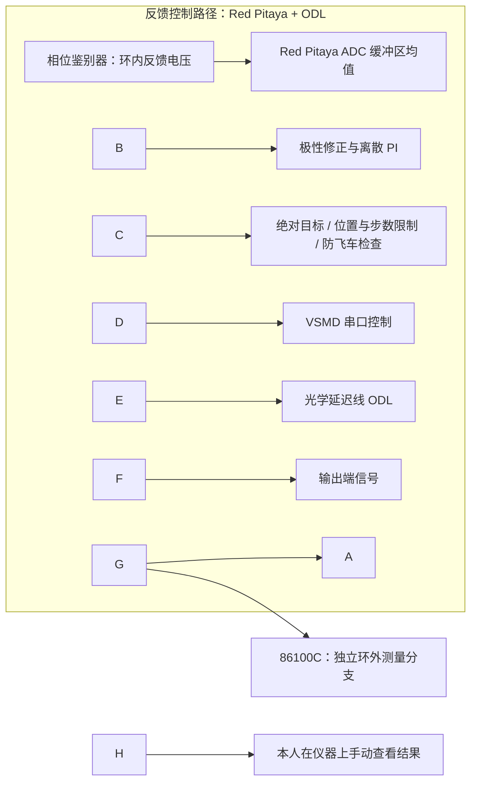

# Phase Stabilization with Discrete PI

本项目包含 **Red Pitaya 上的离散 PI 闭环补偿实现**，以及 **86100C 独立环外测量的实验使用方式**。Red Pitaya 读取相位鉴别器反馈电压，完成 ODL 归零、工作点建立与极性标定，再通过 VSMD 串口命令调整光学延迟线。86100C 独立观察输出端信号；本人当前实验是在仪器上手动查看测量结果。

用于 PI 的鉴相电压属于**环内反馈**，86100C 对独立输出信号的观测属于**环外测量**。示波器读数不输入 PI，也不参与控制量计算。正式实验可以关闭板端数据记录，直接运行 C++ 程序。

!\[系统框图](docs/系统框图.png)

图示表达控制与观测关系，具体实验接线须以实际系统为准。相位与电压的换算需要实验标定；
# 硬件运行与环外观测

Red Pitaya 采集环内相位误差，以 \(20\,\mathrm{Hz}\) 运行 PI 控制；86100C 用于手动观测输出端信号，进行独立环外验证，不参与反馈。

板端需要 Red Pitaya SDK（`rp.h`、`librp`）及相应调度权限。运行前按实际硬件调整 `config.txt` 和串口路径；运行时长由 `TOTAL_DURATION_MIN` 设置，按 `Ctrl+C` 退出。配置与控制逻辑见[设计说明](docs/DESIGN.md)。## 项目结构与使用权限

`control/` 实现 PI；`startup/` 建立工作点；`hal/` 提供硬件与仿真接口；`comm/` 解析驱动帧；`utils/` 提供保护和日志；`tools/` 提供可选 PI 自动化与分析；`tests/` 使用合成数据和 mock 验证。

没有为整个项目指定开源许可证。公开源码的使用、修改和分发权限需由权利人另行确定；第三方依赖遵循各自声明，见 [依赖说明](THIRD_PARTY_NOTICES.md)。

